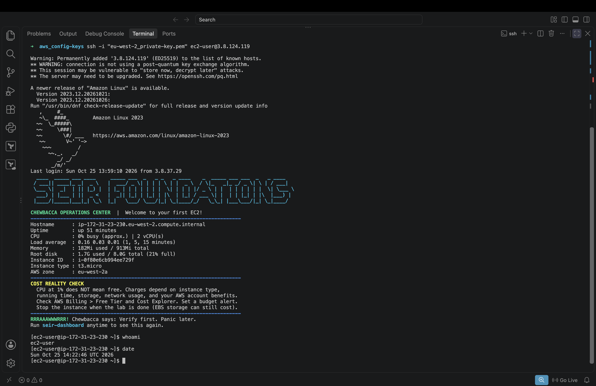
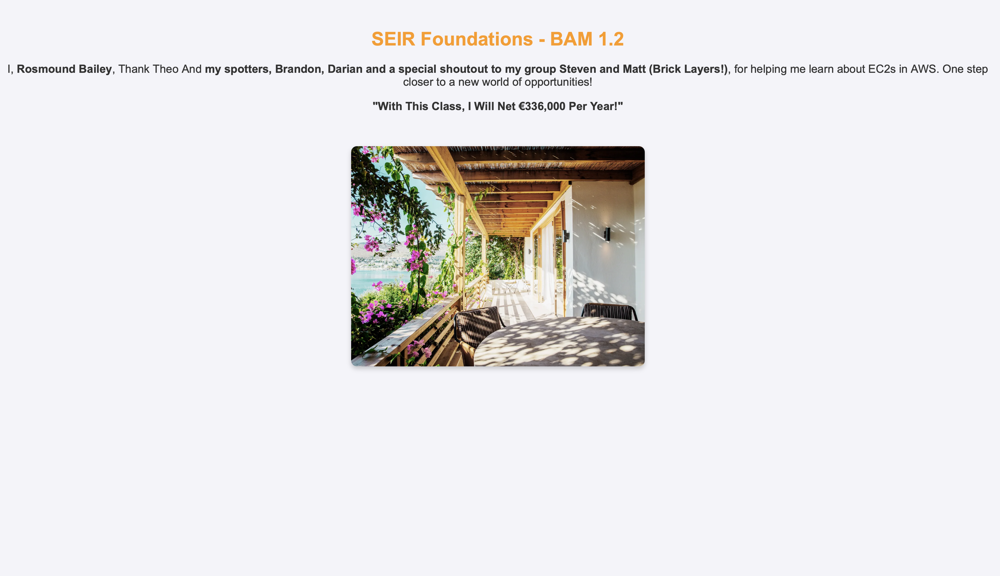
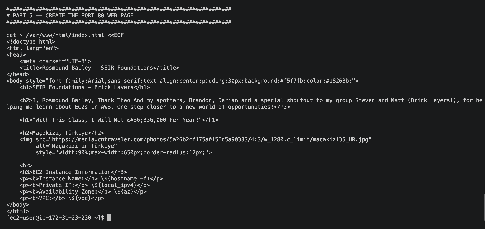

| Item    | Requirement                                       | Screenshot                  | Done?    |
|---------|---------------------------------------------------|-----------------------------|----------|
| BAM_1.1 | Local SSH client; `whoami` + `date` visible       | 
  | (Yes) / No |
| BAM_1.2 | Custom page: thank-you line, dollar line, picture |    | (Yes) / No |
| BAM_1.3 | Local SSH; `user_data` script displayed with `cat` |    | (Yes) / No |

